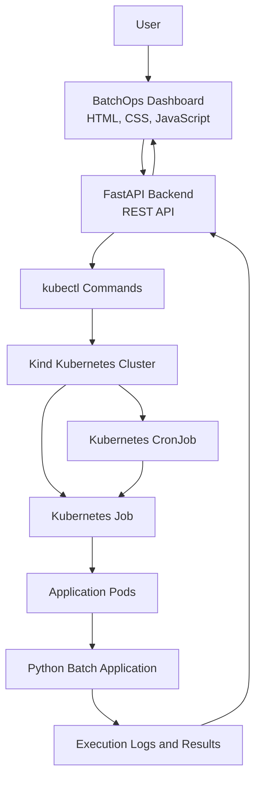
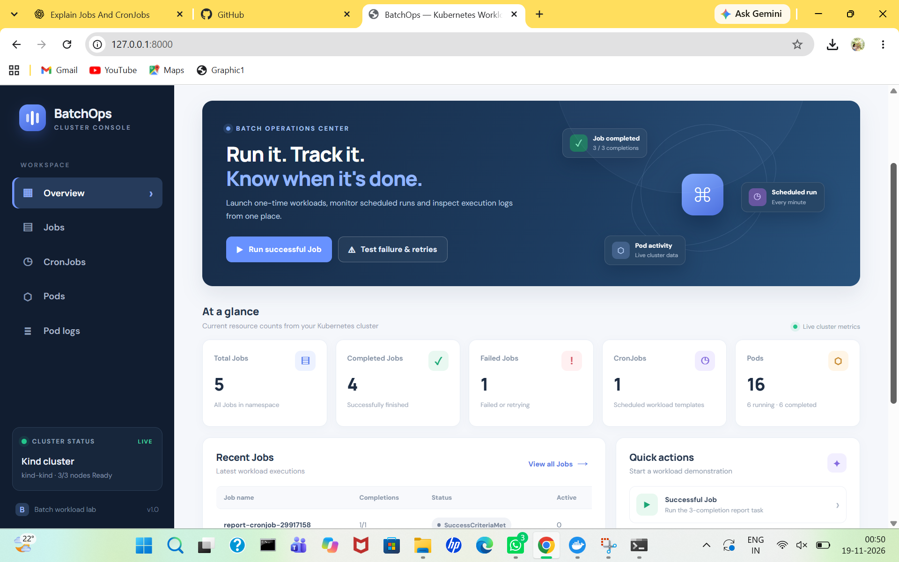
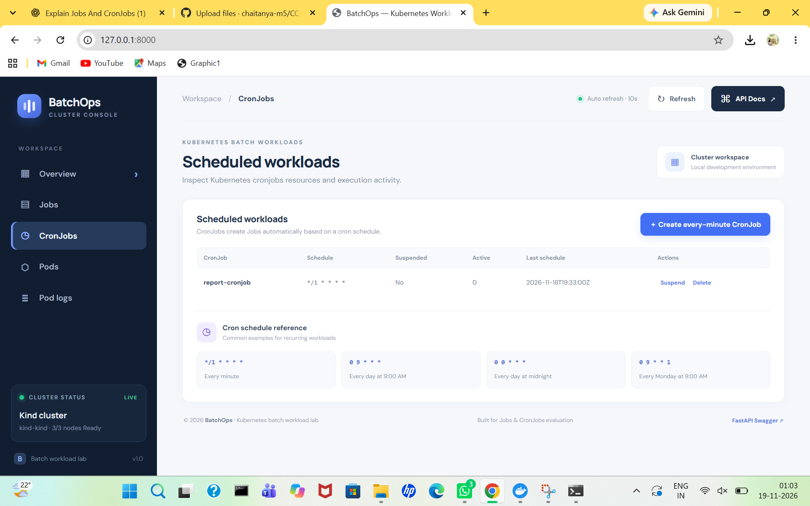
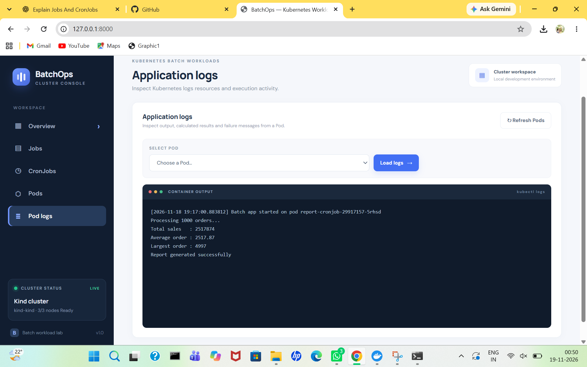
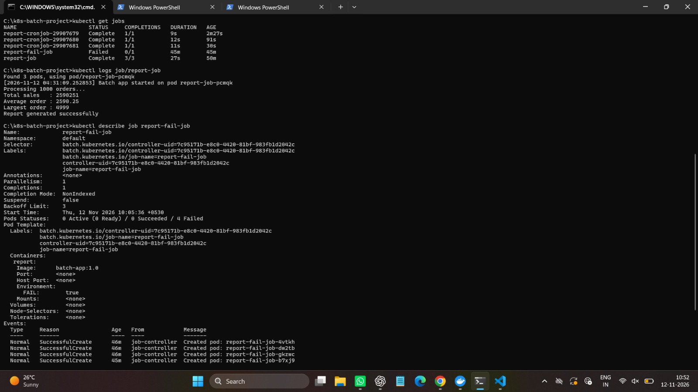
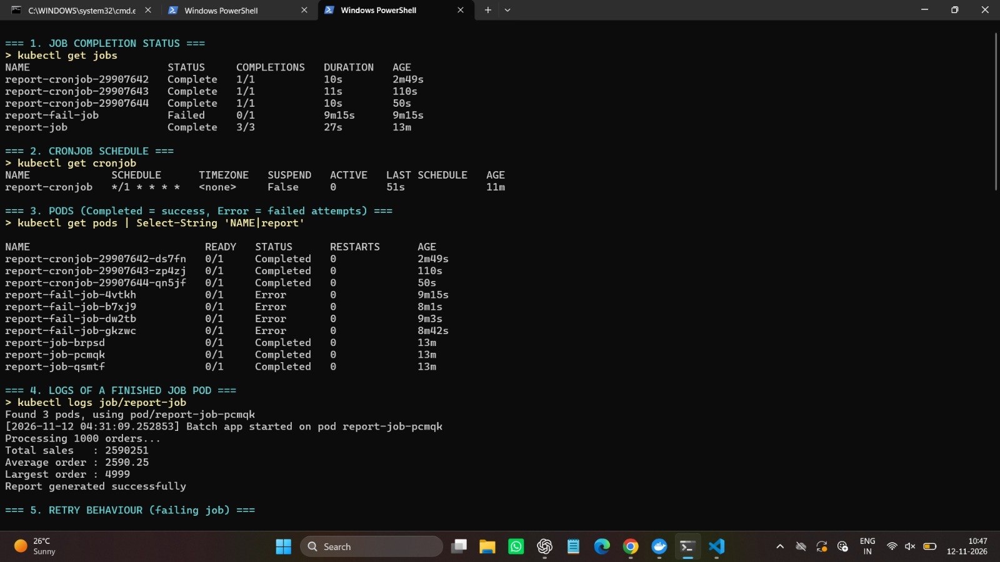
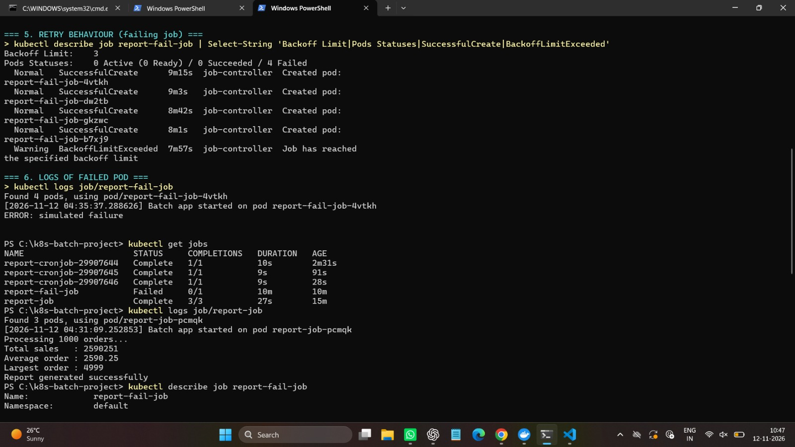

# BatchOps: Kubernetes Jobs and CronJobs Management System

**Containerized Batch Processing | Automated Scheduling | Failure Recovery | Workload Monitoring**


BatchOps is a Kubernetes-based batch workload management and monitoring system designed to demonstrate how containerized applications can be executed, scheduled, monitored, and recovered from failures using Kubernetes Jobs and CronJobs.

The project combines Kubernetes workload orchestration with a custom web dashboard and FastAPI backend, providing a centralized interface to manage batch executions, inspect Pod activity, monitor failures, and retrieve application logs.

Rather than relying entirely on terminal commands, BatchOps provides a visual management interface backed by a REST API that communicates with the Kubernetes cluster through `kubectl`.

---

## Table of Contents

- [Project Overview](#project-overview)
- [Key Features](#key-features)
- [System Architecture](#system-architecture)
- [Technology Stack](#technology-stack)
- [Implementation Workflow](#implementation-workflow)
- [Kubernetes Concepts Implemented](#kubernetes-concepts-implemented)
- [Dashboard Screenshots](#dashboard-screenshots)
- [Experimental Results](#experimental-results)
- [Project Structure](#project-structure)
- [Installation and Execution](#installation-and-execution)
- [API Documentation](#api-documentation)
- [Learning Outcomes](#learning-outcomes)
- [Future Enhancements](#future-enhancements)

---

## Project Overview

Batch processing involves executing finite tasks that perform operations such as data processing, report generation, and periodic computations.

Kubernetes provides native workload controllers that simplify these operations.

This project focuses on two important Kubernetes resources:

**1. Kubernetes Jobs**

A Job creates and manages Pods to execute finite workloads and ensures that a specified number of successful completions is achieved.

**2. Kubernetes CronJobs**

A CronJob creates Jobs automatically according to a configured schedule, enabling recurring batch processing without manual intervention.

The project implements these concepts through a Python-based order-processing application and extends the experiment with a web-based workload management dashboard.

### Project Objectives

- Containerize a Python batch application using Docker.
- Deploy and execute batch workloads using Kubernetes Jobs.
- Configure multiple completions and sequential execution.
- Simulate application failures and observe Kubernetes retry behavior.
- Schedule recurring workloads using CronJobs.
- Monitor Jobs, CronJobs, and Pods.
- Retrieve application logs through Kubernetes.
- Develop a dashboard and REST API for workload management.

---

## Key Features

| Feature | Description |
|---|---|
| Job Management | Create and monitor Kubernetes Jobs |
| Multiple Completions | Execute batch workloads multiple times |
| Failure Simulation | Intentionally trigger application failures |
| Retry Mechanism | Demonstrate Kubernetes retries using `backoffLimit` |
| CronJob Scheduling | Automatically schedule recurring workloads |
| Pod Monitoring | Inspect Pod lifecycle and execution states |
| Log Monitoring | Retrieve application logs from Kubernetes Pods |
| Web Dashboard | Manage and monitor workloads through a graphical interface |
| REST API | Perform workload operations through FastAPI |
| Swagger Documentation | Explore and test API endpoints interactively |

---

## System Architecture

The system follows a layered architecture in which the frontend communicates with a FastAPI backend, which interacts with the Kubernetes cluster through the `kubectl` command-line interface.



### Architecture Components

**Frontend Layer**

Built using HTML, CSS, and JavaScript.

Responsibilities:
- Display workload statistics.
- Show Job and CronJob information.
- Monitor Pod execution status.
- Retrieve and display application logs.
- Trigger workload operations.

**Backend Layer**

Built using FastAPI.

Responsibilities:
- Expose REST API endpoints.
- Execute Kubernetes CLI commands.
- Retrieve cluster workload information.
- Process dashboard requests.
- Return structured JSON responses.

**Kubernetes Orchestration Layer**

A local Kubernetes cluster created using Kind manages workload execution.

Responsibilities:
- Schedule Pods.
- Manage Job completions.
- Handle failed executions.
- Create Jobs from CronJob schedules.
- Maintain workload execution status.

**Application Layer**

A Python batch application simulates order processing.

The application generates 1,000 random order values and calculates:
- Total sales.
- Average order value.
- Largest order value.

It also supports deliberate failure simulation through an environment variable.

---

## Technology Stack

| Technology | Purpose |
|---|---|
| Kubernetes | Container orchestration and workload management |
| Kind | Local Kubernetes cluster |
| Docker | Container image creation |
| Python 3.12 | Batch application |
| FastAPI | Backend REST API |
| HTML5 | Dashboard structure |
| CSS3 | Dashboard styling |
| JavaScript | Frontend interactions |
| YAML | Kubernetes resource configuration |
| kubectl | Cluster management and communication |
| Swagger / OpenAPI | API documentation and testing |

---

## Implementation Workflow

### 1. Containerization

The Python batch application is packaged into a Docker image.

```bash
docker build -t batch-app:1.0 .
```

The image is loaded into the Kind cluster:

```bash
kind load docker-image batch-app:1.0
```

This makes the image available to the Kubernetes nodes without requiring an external image registry.

### 2. Successful Job Execution

The successful Job configuration specifies:

```yaml
completions: 3
parallelism: 1
backoffLimit: 4
```

This configuration means:
- Three successful executions are required.
- Only one Pod executes at a time.
- Failed executions can be retried according to the configured backoff limit.

Apply the configuration:

```bash
kubectl apply -f job-app.yaml
```

Inspect the Job:

```bash
kubectl get jobs
kubectl describe job report-job
```

View application output:

```bash
kubectl logs job/report-job
```

### 3. Failure Handling and Retry Mechanism

Failure simulation is implemented using an environment variable:

```yaml
env:
  - name: FAIL
    value: "true"
```

The Python application checks this variable:

```python
if os.getenv("FAIL") == "true":
    print("ERROR: simulated failure")
    sys.exit(1)
```

The failure Job uses:

```yaml
backoffLimit: 3
restartPolicy: Never
```

Kubernetes creates new Pods for retry attempts after failed executions, until the configured retry limit is reached.

Apply:

```bash
kubectl apply -f job-app-fail.yaml
```

Monitor:

```bash
kubectl get jobs
kubectl get pods
kubectl describe job report-fail-job
```

### 4. Automated CronJob Scheduling

The CronJob uses the following schedule:

```yaml
schedule: "*/1 * * * *"
```

This schedules the workload once every minute.

The CronJob creates Jobs automatically, and those Jobs create Pods to execute the batch application.

Apply:

```bash
kubectl apply -f cronjob-app.yaml
```

Monitor:

```bash
kubectl get cronjobs
kubectl get jobs
kubectl get pods
```

The configuration also maintains execution history:

```yaml
successfulJobsHistoryLimit: 3
failedJobsHistoryLimit: 1
```

---

## Kubernetes Concepts Implemented

| Concept | Implementation |
|---|---|
| Job | Finite batch workload execution |
| CronJob | Recurring workload scheduling |
| Pod | Execution environment for the container |
| Completions | Required successful executions |
| Parallelism | Maximum concurrent Job Pods |
| backoffLimit | Retry limit for failed Pods |
| restartPolicy | Pod restart behavior |
| Environment Variables | Runtime failure simulation |
| Image Pull Policy | Local image usage through `IfNotPresent` |
| Job History Limits | Retention of successful and failed CronJob executions |

---

## Dashboard Screenshots

The BatchOps dashboard provides a centralized interface for managing and monitoring Kubernetes batch workloads.

### 1. Workload Management Dashboard

Displays the main dashboard, Job information, workload statistics, and execution status.



### 2. CronJob Scheduling and Management

Displays scheduled workloads and CronJob information, demonstrating automated batch execution management.



### 3. Application Execution Logs

Displays the output generated by the Python batch application, allowing users to inspect workload execution results.



---

## Experimental Results

The experiment successfully demonstrates three major outcomes.

### Result 1: Successful Batch Processing

A Kubernetes Job was configured with:

- `completions: 3`
- `parallelism: 1`

**Observed Result:** All three application Pods completed successfully.

The batch application processed 1,000 randomly generated orders during each execution and generated sales statistics.



### Result 2: Failure Detection and Retry Handling

A deliberate application failure was triggered using `FAIL=true`.

Configuration:
- `backoffLimit: 3`
- `restartPolicy: Never`

**Observed Result:** Four failed Pod attempts were recorded: one initial attempt and three retries. Kubernetes subsequently marked the Job as failed.



### Result 3: Automated CronJob Execution

The CronJob was configured with:

```yaml
schedule: "*/1 * * * *"
```

**Observed Result:** Kubernetes automatically created separate Jobs at scheduled intervals. The two observed executions completed successfully.



---

## Project Structure

```text
CC-Jobs-and-Cronjobs-for-Batch-Workloads/
│
├── app.py
├── Dockerfile
├── job-app.yaml
├── job-app-fail.yaml
├── cronjob-app.yaml
├── show-results.ps1
├── README.md
│
└── screenshots/
    ├── 01-batch-workload-verification.jpeg
    ├── 01-dashboard-jobs-overview.png
    ├── 02-dashboard-jobExecutions.png
    ├── 02-job-inspection-details.jpeg
    ├── 03-dashboard-cronjobs.png
    ├── 03-job-failure-retry-behavior.jpeg
    ├── 04-dashboard-podinventory.png
    ├── 04-job-cronjob-execution-overview.jpeg
    └── 05-dashboard-logs.png
```

---

## Installation and Execution

### Prerequisites

Ensure the following tools are installed:

- Docker Desktop
- Kubernetes CLI (`kubectl`)
- Kind
- Python 3.12 or compatible Python version

### 1. Clone the Repository

```bash
git clone https://github.com/chaitanya-m5/CC-Jobs-and-Cronjobs-for-Batch-Workloads.git
```

Navigate into the project:

```bash
cd CC-Jobs-and-Cronjobs-for-Batch-Workloads
```

### 2. Verify the Kubernetes Cluster

```bash
kind get clusters
kubectl get nodes
```

### 3. Build the Docker Image

```bash
docker build -t batch-app:1.0 .
```

### 4. Load the Image into Kind

```bash
kind load docker-image batch-app:1.0
```

### 5. Execute the Successful Job

```bash
kubectl apply -f job-app.yaml
kubectl get jobs
kubectl get pods
```

### 6. Test Failure Handling

```bash
kubectl apply -f job-app-fail.yaml
kubectl get pods
kubectl describe job report-fail-job
```

### 7. Deploy the CronJob

```bash
kubectl apply -f cronjob-app.yaml
kubectl get cronjobs
kubectl get jobs
```

### 8. Inspect Application Logs

```bash
kubectl logs job/report-job
```

---

## API Documentation

The BatchOps dashboard is supported by a FastAPI backend that exposes REST endpoints for workload monitoring and management.

Once the backend is running, access the interactive Swagger documentation at:

**http://127.0.0.1:8000/docs**

The API provides operations for:

- Checking backend health.
- Retrieving cluster summaries.
- Listing Jobs.
- Listing CronJobs.
- Listing Pods.
- Retrieving Pod logs.
- Triggering successful Jobs.
- Triggering failure Jobs.
- Creating CronJobs.
- Suspending and resuming CronJobs.
- Deleting Jobs and CronJobs.

The backend acts as a bridge between the frontend and Kubernetes through `kubectl`.

---

## Learning Outcomes

Through this project, the following practical concepts were explored:

- Containerizing Python applications using Docker.
- Deploying and managing workloads in Kubernetes.
- Understanding the difference between Jobs and CronJobs.
- Configuring Job completions and parallelism.
- Implementing failure scenarios and retry policies.
- Understanding Pod lifecycle states.
- Scheduling recurring workloads using cron expressions.
- Inspecting Kubernetes events and application logs.
- Building a web interface for cluster workload management.
- Integrating FastAPI with Kubernetes CLI operations.

---

## Future Enhancements

Potential improvements include:

- Historical workload execution analytics.
- Advanced filtering and searching of Jobs.
- Configurable resource requests and limits.
- Workload execution duration tracking.
- Notifications for failed workloads.
- Multi-cluster monitoring.
- Role-based access control and authentication.

---

## Author

**Chaitanya Muchandi**
GitHub: [@chaitanya-m5](https://github.com/chaitanya-m5)

Repository: [CC-Jobs-and-Cronjobs-for-Batch-Workloads](https://github.com/chaitanya-m5/CC-Jobs-and-Cronjobs-for-Batch-Workloads)

---

**Project Focus:** Kubernetes batch workload orchestration, automated scheduling, failure recovery, and visual workload monitoring.
